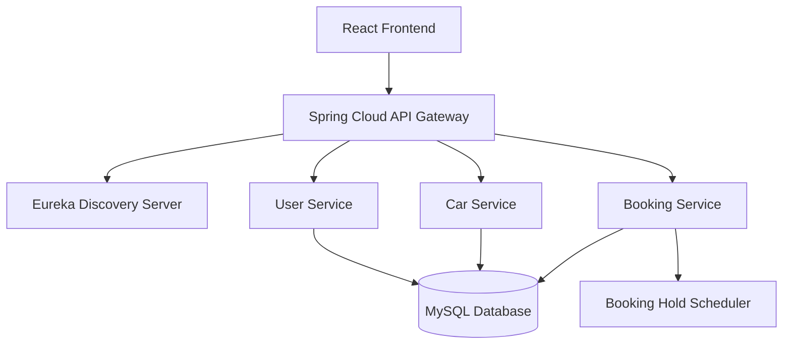

# 🚗 Car Rental Management Application

A full-stack Car Rental Management System developed using **React.js, Java Spring Boot Microservices, and MySQL**. The application provides a platform for users to browse available cars, select rental dates, calculate rental charges, and manage car bookings.

The system focuses on secure user authentication, efficient booking management, and preventing conflicting bookings through database locking and temporary booking holds.

## 📌 Project Overview

The Car Rental Management Application is designed to simplify the car rental process through a user-friendly web interface and a scalable microservices-based backend architecture.

Users can register, log in, explore cars, check availability, select rental periods, and book vehicles. The backend manages booking requests, rental calculations, and database operations to ensure reliable and consistent booking information.

## ✨ Key Features

- User Registration and Login
- JWT-Based Authentication
- BCrypt Password Encryption
- Car Listing and Car Details
- Car Availability Checking
- Rental Date Selection
- Automatic Rental Duration Calculation
- Rental Cost Estimation
- Secure Car Booking
- Unique Booking Reference Generation
- My Bookings and Booking Status Tracking
- Temporary Booking Holds
- Automatic Hold Expiration
- Pessimistic Write Locking for Concurrent Bookings
- Centralized Exception Handling
- Responsive React User Interface
- REST API Integration
- MySQL Database Persistence

## 🛠️ Technology Stack

### Frontend
- HTML5
- CSS3
- JavaScript
- React.js
- React Router
- Axios
- React Hooks
- Lucide React Icons

### Backend
- Java 17
- Spring Boot
- Spring Cloud Gateway
- Netflix Eureka Discovery Server
- Spring Data JPA
- Hibernate
- Spring Security
- JWT Authentication
- BCrypt
- REST APIs
- Spring Transaction Management
- Spring Scheduling
- `@Transactional`
- `@Scheduled`
- `@ControllerAdvice`
- Pessimistic Write Locking

### Database
- MySQL

### Development and Testing Tools
- IntelliJ IDEA
- Visual Studio Code
- Maven
- Postman
- Git
- GitHub

## 🏗️ System Architecture

The application follows a microservices architecture.



### Microservices

| Microservice | Responsibility |
|---|---|
| Eureka Discovery Server | Registers and discovers backend services |
| API Gateway | Routes frontend requests to the appropriate service |
| User Service | User registration, login, and authentication |
| Car Service | Car details, listing, and availability |
| Booking Service | Booking creation, rental calculation, and booking management |
| Booking Hold Scheduler | Automatically releases expired temporary booking holds |

## 🔄 Application Workflow

1. The user registers or logs into the application.
2. The user browses the available cars.
3. The user selects a car.
4. The user enters the rental start date and end date.
5. The system calculates the rental duration.
6. The backend calculates the total rental amount using the daily rental rate.
7. The Booking Service checks the car's availability.
8. A temporary booking hold is created for an available car.
9. The user confirms the booking before the hold expires.
10. The backend saves the confirmed booking in MySQL.
11. A unique booking reference is generated.
12. The user receives a booking confirmation.
13. The user can view booking details in the My Bookings section.

## 🔐 Booking Concurrency Management

The application uses pessimistic write locking to prevent multiple users from booking the same car for overlapping rental dates.

### Booking Conflict Prevention

- Uses `PESSIMISTIC_WRITE` locking.
- Uses `@Transactional` for database consistency.
- Checks existing bookings and active temporary holds.
- Validates rental date ranges.
- Prevents overlapping bookings.
- Returns HTTP 409 Conflict when a booking cannot be completed due to a conflict.

### Temporary Booking Holds

Temporary booking holds reserve a car for a limited duration while a user completes the booking process.

- Hold information is stored in MySQL.
- Each hold includes an expiration timestamp (`expires_at`).
- The hold duration is configurable.
- A scheduled task identifies expired holds.
- Expired holds are released automatically.
- Released holds no longer prevent other users from booking the car.

## 🗄️ Database Design

The application uses MySQL for persistent data storage.

### Users Table
Stores user account information.

- `user_id`
- `email`
- `password_hash`
- `role`
- `created_at`
- `updated_at`

### Cars Table
Stores car details and rental information.

- `car_id`
- `model_name`
- `brand`
- `car_number`
- `image_url`
- `daily_rate`
- `availability_status`
- `description`

### Bookings Table
Stores confirmed and tracked rental bookings.

- `booking_id`
- `booking_reference`
- `user_id`
- `car_id`
- `rental_start_date`
- `rental_end_date`
- `total_days`
- `daily_rate`
- `total_amount`
- `booking_status`

### Booking Holds Table
Stores temporary reservations.

- `hold_id`
- `car_id`
- `user_id`
- `booking_reference`
- `rental_start_date`
- `rental_end_date`
- `total_days`
- `total_amount`
- `expires_at`
- `hold_status`
- `created_at`

## 💰 Rental Cost Calculation

The total rental cost is calculated using the following formula:

**Total Rental Amount = Daily Rental Rate × Total Rental Days**

Example:

| Description | Value |
|---|---|
| Daily Rental Rate | ₹2,000 |
| Rental Start Date | 20 October 2026 |
| Rental End Date | 23 October 2026 |
| Total Rental Days | 3 Days |
| Total Rental Amount | ₹6,000 |

The backend calculates the authoritative rental amount using the daily rate stored in MySQL.

## 📡 REST API Endpoints

### Authentication APIs

| Method | Endpoint | Description |
|---|---|---|
| POST | `/api/auth/register` | Register a new user |
| POST | `/api/auth/login` | Authenticate a user |

### Car APIs

| Method | Endpoint | Description |
|---|---|---|
| GET | `/api/cars` | Retrieve all cars |
| GET | `/api/cars/{carId}` | Retrieve car details |
| GET | `/api/cars/{carId}/availability` | Check car availability |

### Booking APIs

| Method | Endpoint | Description |
|---|---|---|
| POST | `/api/bookings/estimate` | Calculate rental estimate |
| POST | `/api/bookings/holds` | Create a temporary booking hold |
| POST | `/api/bookings/{bookingReference}/confirm` | Confirm a booking |
| GET | `/api/bookings/{bookingReference}` | Retrieve booking details |
| GET | `/api/bookings/my` | Retrieve the authenticated user's bookings |

*Note: API paths should be updated to match the actual Gateway routes configured in the project.*

## 📂 Project Structure

```text
Car-Rental-Management-Application/
│
├── api-gateway/
│
├── eureka-server/
│
├── user-service/
│
├── car-service/
│
├── booking-service/
│
├── frontend/
│
├── database/
│   ├── schema.sql
│   └── sample-data.sql
│
├── README.md
└── .gitignore
```

## ⚙️ Installation and Setup

### Prerequisites

Install the following software:

- Java 17
- Apache Maven
- Node.js and npm
- MySQL Server
- IntelliJ IDEA
- Visual Studio Code
- Postman

### 1. Clone the Repository

```bash
git clone https://github.com/Vaibhavasri2005/Car-Rental-Management-Application.git
```

Navigate to the project directory:

```bash
cd Car-Rental-Management-Application
```

### 2. Configure MySQL

Create the database:

```sql
CREATE DATABASE car_rental_db;
```

Configure the MySQL database connection in the application configuration files.

Example:

```properties
spring.datasource.url=jdbc:mysql://localhost:3306/car_rental_db
spring.datasource.username=${DB_USERNAME}
spring.datasource.password=${DB_PASSWORD}
```

Use environment variables for database credentials.

### 3. Start the Backend Microservices

Start the services in the following order:

1. Eureka Discovery Server
2. API Gateway
3. User Service
4. Car Service
5. Booking Service

Run each Spring Boot service using IntelliJ IDEA or Maven.

```bash
mvn spring-boot:run
```

Verify that the services are registered with Eureka.

### 4. Start the React Frontend

Navigate to the frontend directory:

```bash
cd frontend
```

Install the dependencies:

```bash
npm install
```

Start the development server:

```bash
npm run dev
```

Open the application using the local URL displayed in the terminal.

### 5. Test the Application

Use Postman to test the REST APIs.

Test the following operations:

- User registration
- User login
- Retrieve car listings
- Check car availability
- Calculate rental cost
- Create a booking hold
- Confirm a booking
- Retrieve booking details
- Retrieve user bookings
- Verify overlapping booking conflicts
- Verify automatic hold expiration

## 🧪 Testing

The application can be tested using Postman and automated tests.

Important test scenarios:

- Valid and invalid user registration
- Authentication and JWT validation
- Car availability validation
- Rental duration calculation
- Rental cost calculation
- Booking creation and confirmation
- Duplicate and overlapping booking prevention
- Concurrent booking requests
- Temporary booking hold expiration
- Unauthorized booking access
- Centralized exception handling

## 🔒 Security

The application incorporates the following security practices:

- JWT-based authentication
- BCrypt password hashing
- Protected REST endpoints
- User-specific booking access
- Backend validation of rental information
- Secure handling of database credentials
- Centralized error handling

## 🚀 Future Enhancements

- Online Payment Gateway Integration
- Email Booking Confirmation
- Advanced Car Search and Filtering
- Admin Dashboard
- Customer Feedback and Ratings
- Rental Invoice Generation
- Deployment using Docker
- Cloud Deployment

## 👩‍💻 Developer

**Vaibhava Sri L.**

GitHub: [Vaibhavasri2005](https://github.com/Vaibhavasri2005)

## 📄 License

This project is developed for educational purposes and demonstrates full-stack web development using React, Java Spring Boot Microservices, and MySQL.
